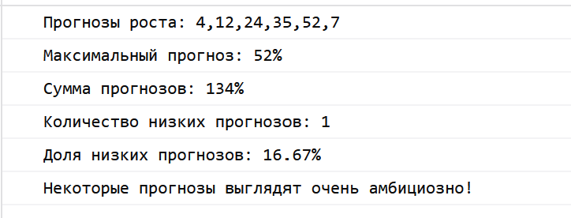
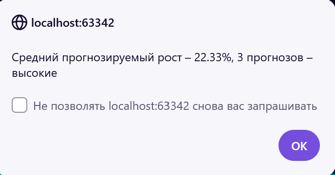
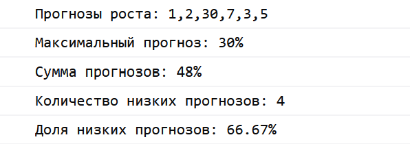
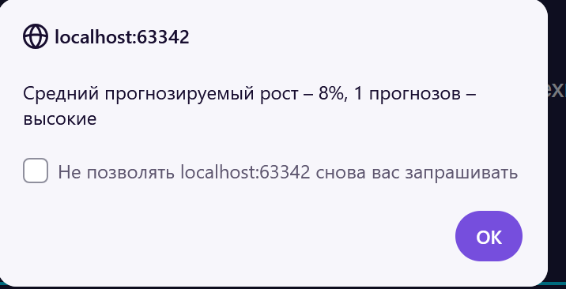

Лабораторная работа №4 Лев Патрушев Вариант: №20

В программе используется массив из шести чисел: 4, 12, 24, 35, 52, 7. Эти числа обозначают прогнозируемый годовой рост технологий и рынков в процентах.

1. Ввод и вывод
   Функция prompt() запрашивает имя пользователя. Если имя не введено, используется имя «Гость».
   Первый вызов alert() выводит приветствие. Второй вызов показывает средний прогнозируемый рост и количество высоких прогнозов.
   Функция console.log() выводит исходный массив, максимальный прогноз, сумму, количество низких прогнозов и их долю.

2. Функции
   Функция findMaximum() находит максимальное значение в массиве.
   Функция filterHighForecasts() создаёт новый массив со значениями больше 20%.
   Функция calculateSum() подсчитывает сумму всех значений.
   Функция countLowForecasts() подсчитывает прогнозы, которые меньше или равны 5%.
   Функция runForecastAnalysis() вызывает остальные функции, выполняет расчёты и выводит результаты.

3. Пример работы

    

   Для массива 4, 12, 24, 35, 52, 7 сумма равна 134%, а среднее значение равно 22.33%.
   Высокими считаются значения больше 20%. Таких значений три: 24, 35, 52.
   Низким считается значение 4%. Количество низких прогнозов равно 1, их доля составляет 16.67%.

   Окно alert() выводит: 

  Дан массив 1, 2, 30, 7, 3, 5.

  

  alert(): 
